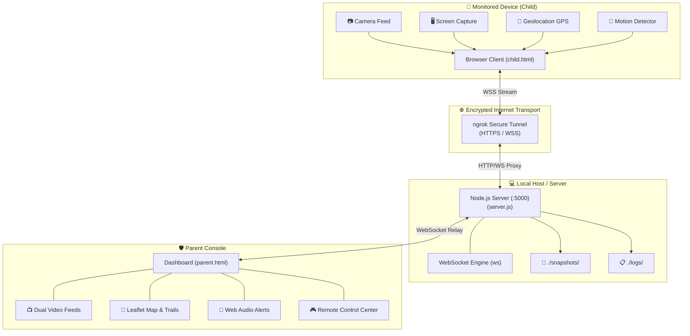

# 🛡️ Screen Monitor — Agent Edition

> **Zero-install, real-time remote monitoring platform for parental safety and device oversight.**  
> Stream live screen and camera feeds, track real-time GPS locations on an interactive dark-mode map, and receive instant acoustic motion alerts with automatic snapshot capture.

---

## 📋 Overview

**Screen Monitor** is designed for parental supervision, child safety, and device tracking. It removes the friction of installing third-party mobile applications: the monitored device simply opens a secure browser link (`child.html`), which immediately connects to the parent command dashboard (`parent.html`) over an encrypted WebSocket tunnel.

### ✨ Key Features at a Glance

- 📺 **Simultaneous Dual-Feed Streaming**: Live high-resolution video feeds of the device screen and camera (with remote front/rear switching).
- 📍 **Real-Time GPS Tracking**: Satellite geolocation tracking displayed on an interactive dark-mode Leaflet map with breadcrumb trails and reverse geocoded street addresses.
- 🎯 **Super-Sensitive Motion & Activity Engine**: Canvas-based pixel diffing detects physical camera motion and screen activity (app switching, typing, scrolling), triggering instant acoustic chime alerts.
- 📸 **Automatic High-Def Snapshots**: Captures motion-triggered and periodic JPEG snapshots directly to disk, with 1-click downloads to the parent machine.
- 🎮 **Remote Control Commands**: Remotely flip cameras, trigger snapshots, request GPS fixes, adjust motion sensitivity, or restart streams from the parent console.
- ⚡ **Zero-Drop Connection Persistence**: Bi-directional heartbeats, TCP keep-alive, and automatic reconnect recovery (under 600ms) ensure rock-solid stability over Wi-Fi and cellular networks.
- 🌐 **Encrypted Public Access via ngrok**: Pre-configured tunnel allows remote devices to connect over the internet without manual router port-forwarding.

---

## 🏛️ System Architecture



---

## ⚡ Quick Start Guide

### Prerequisites
- [Node.js](https://nodejs.org/) (v16 or higher)
- Optional: [ngrok](https://ngrok.com/) (for monitoring outside your local Wi-Fi network)

---

### Option 1: 1-Click Launcher on Windows (Recommended)

Double-click **`start.bat`** in the project directory.

The script automatically:
1. Cleans up any leftover background processes from previous runs to prevent `ERR_NGROK_334` conflicts.
2. Starts the Node.js server on port `5000`.
3. Launches the ngrok tunnel window.
4. Opens the **Parent Dashboard** in your default web browser.

> 💡 **To Stop Services**: Double-click **`stop.bat`** to cleanly terminate all processes at any time.

---

### Option 2: Cross-Platform Command Line (Windows, macOS, Linux)

1. **Install Dependencies**:
   ```bash
   npm install
   ```

2. **Start the Server**:
   ```bash
   node server.js
   ```

3. **Start the ngrok Tunnel** (in a separate terminal):
   ```bash
   ngrok http 5000 --url https://chunk-refinance-breeching.ngrok-free.dev
   ```

4. **Open the Dashboards**:
   - Parent: `http://localhost:5000/parent` (or open `parent.html` directly in Chrome)
   - Child: `http://localhost:5000/child` (or public ngrok URL for mobile devices)

---

## 🔗 Connection URLs

| Environment | Purpose | URL |
| :--- | :--- | :--- |
| **🌐 Public Internet** | Parent Console | `https://chunk-refinance-breeching.ngrok-free.dev/parent` |
| **🌐 Public Internet** | Child Share Link | `https://chunk-refinance-breeching.ngrok-free.dev/child` |
| **🏠 Local Network** | Parent Console | `http://localhost:5000/parent` |
| **🏠 Local Network** | Child Share Link | `http://localhost:5000/child` |
| **📊 REST Telemetry** | Server Status | `http://localhost:5000/status` |
| **📸 Evidence API** | Snapshots API | `http://localhost:5000/snapshots` |
| **📋 Audit Trail** | Session Event Logs | `http://localhost:5000/logs` |

---

## 🎮 Parent Dashboard Controls

| Button / Control | Description |
| :--- | :--- |
| **`📋 COPY CHILD LINK`** | Copies the public child monitor link to your clipboard with 1-click confirmation. |
| **`💾 SCREEN` / `💾 CAM`** | Downloads the current live high-resolution frame directly to your laptop as a JPEG. |
| **`📸 SNAP`** | Sends a remote command instructing the child device to capture and archive a full-res still. |
| **`🔄 FLIP`** | Remotely toggles the child device camera between front (selfie) and rear lenses. |
| **`📍 GPS`** | Forces an immediate satellite geolocation update from the device. |
| **`⚡ SENSITIVITY`** | Adjusts real-time motion detection thresholds between **Ultra**, **High**, and **Normal**. |
| **`↺ RESTART`** | Remotely resets and reinitializes video streams on the target device. |
| **`⏹ STOP`** | Remotely terminates the child device monitoring session. |

---

## ⚙️ Configuration & Environment Variables

Customize server behavior by passing environment variables:

```bash
PORT=5000                                           # Port to listen on (Default: 5000)
NGROK_DOMAIN="chunk-refinance-breeching.ngrok-free.dev" # Your custom ngrok static domain
PARENT_PASSWORD="your-secure-password"             # Optional password protection for parent console
```

Example:
```bash
PORT=8080 PARENT_PASSWORD=Secret123 node server.js
```

---

## 🗂 Project Structure

```
Screenmonitor/
├── parent.html        # Parent monitor console, controls, audio chime & map
├── child.html         # Lightweight client app (camera, screen, GPS & motion)
├── server.js          # Node.js WebSocket relay server & snapshot archiver
├── start.bat          # 1-click automated Windows launcher with process cleanup
├── stop.bat           # 1-click clean termination utility for Windows
├── package.json       # Project dependencies & metadata
├── README.md          # Comprehensive documentation
├── .gitignore         # Ignores node_modules, logs, and private snapshots
├── snapshots/         # Auto-created directory storing motion-captured JPEGs
└── logs/              # Auto-created directory storing daily JSONL audit logs
```

---

## 🔒 Security & Privacy Notice

- **Camera & Screen Permissions**: The child device must explicitly grant browser permissions for screen recording, camera access, and geolocation.
- **Data Protection**: Frames are streamed peer-to-peer through your dedicated Node.js relay and are never forwarded to third-party cloud analytics.
- **Responsible Use**: This software is intended strictly for authorized parental supervision, personal safety, and consensual device administration.
